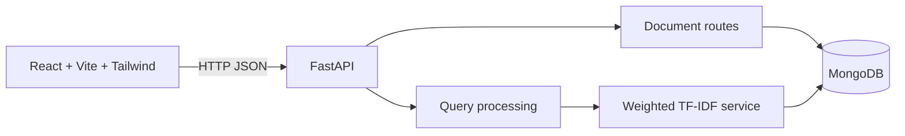

# Document Search System

## Overview

Document Search System is a full-stack application for storing project
documentation and retrieving relevant documents. Users can search with keywords
or ask a natural-language question. Retrieval is deterministic and explainable:
the backend preprocesses text and ranks documents with weighted TF-IDF and
cosine similarity.

The sample dataset contains fictional technical documents only.

## Features

- Document creation, listing, retrieval, update, and deletion.
- MongoDB persistence through PyMongo.
- Weighted TF-IDF document retrieval.
- Cosine-similarity relevance scores normalized to `0.0–1.0`.
- Deterministic relevance ordering and matched-field explanations.
- Rule-based natural-language query preprocessing.
- React knowledge workspace with keyword and natural-language modes, search
  history, quick examples, and document CRUD views.
- Responsive desktop sidebar, tablet navigation, and an accessible mobile
  navigation drawer.
- Loading, empty, validation, and backend-error states.
- Ten fictional, idempotently seeded sample documents.

## Technology stack

### Backend

- Python 3.9+
- FastAPI `0.115.12`
- Pydantic `2.11.3`
- PyMongo `4.12.1`
- Uvicorn `0.34.2`
- python-dotenv `1.1.0`
- Pytest `8.3.5`
- HTTPX `0.28.1`

### Frontend

- JavaScript
- React `19.3.1`
- React DOM `19.3.1`
- Vite `8.3.8` (installed from the `^8.3.6` manifest range)
- Tailwind CSS `4.3.5`
- Oxlint `1.90.0`

### Database

- MongoDB
- Database: `document_search_db`
- Collection: `documents`

## Architecture



The frontend calls the FastAPI backend using `VITE_API_BASE_URL`. FastAPI
validates requests, manages MongoDB lifecycle, and exposes CRUD and retrieval
routes. Search routes load the required document fields into the explainable
in-memory search service.

## Project structure

```text
document-search-system/
├── backend/
│   ├── app/
│   │   ├── main.py
│   │   ├── config.py
│   │   ├── database.py
│   │   ├── models/
│   │   ├── routes/
│   │   │   └── documents.py
│   │   ├── schemas/
│   │   │   ├── document.py
│   │   │   └── search.py
│   │   ├── services/
│   │   │   ├── documents.py
│   │   │   ├── query_processing.py
│   │   │   └── search.py
│   │   └── utils/
│   ├── scripts/
│   │   └── seed_sample_data.py
│   ├── tests/
│   ├── requirements.txt
│   └── .env.example
├── frontend/
│   ├── src/
│   │   ├── components/
│   │   ├── services/api.js
│   │   ├── App.jsx
│   │   └── main.jsx
│   ├── public/favicon.svg
│   ├── index.html
│   ├── package.json
│   └── .env.example
├── sample_data/
│   └── documents.py
├── .python-version
├── README.md
└── .gitignore
```

## Prerequisites

- Python 3.9 or newer.
- Node.js and npm.
- A reachable MongoDB instance, either local MongoDB or MongoDB Atlas.
- A MongoDB user with access limited to the application database.

## Environment configuration

### Backend

Copy [backend/.env.example](backend/.env.example) to `backend/.env` and set:

```env
MONGODB_URI=mongodb://localhost:27017
MONGODB_DATABASE=document_search_db
CORS_ORIGINS=http://localhost:5173,http://127.0.0.1:5173
```

For MongoDB Atlas, replace only `MONGODB_URI` with the connection string
provided by Atlas. Do not commit `backend/.env`.

### Frontend

Copy [frontend/.env.example](frontend/.env.example) to `frontend/.env`:

```env
VITE_API_BASE_URL=http://127.0.0.1:8001
```

The frontend environment must contain only the backend URL. Never put a
MongoDB URI, password, or other database credential in frontend configuration.

## Backend setup and run

```bash
cd backend
python3 -m venv .venv
source .venv/bin/activate
python -m pip install -r requirements.txt
cp .env.example .env
uvicorn app.main:app --reload --host 127.0.0.1 --port 8001
```

If `backend/.env` already exists, preserve it and update only non-secret
settings as needed. API documentation is available at
http://127.0.0.1:8001/docs.

## Frontend setup and run

```bash
cd frontend
npm install
cp .env.example .env
npm run dev -- --host 127.0.0.1 --port 5173
```

Open http://127.0.0.1:5173.

## Production deployment

The current deployment uses Vercel for the React frontend, Render for the
FastAPI backend, and MongoDB Atlas for persistence:

- Frontend: https://frontend-alpha-bay-lr2jg625qe.vercel.app/
- Backend: https://docu-search-system.onrender.com
- API documentation: https://docu-search-system.onrender.com/docs

For Render, use `backend` as the service root directory and configure:

```bash
pip install -r requirements.txt
uvicorn app.main:app --host 0.0.0.0 --port $PORT
```

The root `.python-version` file pins the Render runtime to Python 3.11.11.
Set these Render environment variables without committing their values:

```env
MONGODB_URI=<MongoDB Atlas connection string>
MONGODB_DATABASE=document_search_db
CORS_ORIGINS=https://frontend-alpha-bay-lr2jg625qe.vercel.app,http://localhost:5173,http://127.0.0.1:5173
```

For Vercel, set `VITE_API_BASE_URL` to the Render backend URL for the
Production and Preview environments. Render's free service may sleep when
idle, so the first request after inactivity can take longer.

## Sample data

The ten fictional documents are defined in
[sample_data/documents.py](sample_data/documents.py). Seed them manually:

```bash
cd backend
PYTHONPATH=.. .venv/bin/python -m scripts.seed_sample_data
```

The script uses an internal `_sample_data_key` marker and updates only its own
records. Running it repeatedly does not create duplicates and does not delete
or overwrite unrelated documents. It is not executed during FastAPI startup.

## Database document structure

Each stored document contains:

```json
{
  "_id": "MongoDB ObjectId",
  "name": "Database Fundamentals",
  "category": "Database",
  "description": "A practical introduction to relational database concepts.",
  "content": "Document content...",
  "created_at": "UTC datetime",
  "updated_at": "UTC datetime"
}
```

The seed marker is internal and is excluded from public CRUD and search
responses.

## API documentation

### Health

#### `GET /health`

Returns basic application health:

```json
{"status": "ok"}
```

#### `GET /health/database`

Pings MongoDB and returns the configured database and collection:

```json
{
  "status": "ok",
  "database": "document_search_db",
  "collection": "documents"
}
```

Database failures return HTTP `503` without exposing internal details.

### Document CRUD

#### `POST /documents`

Creates a document. Required fields are `name`, `category`, `description`, and
`content`. Empty and whitespace-only values are rejected. Returns HTTP `201`.

#### `GET /documents?skip=0&limit=20`

Lists documents with pagination. `skip` must be non-negative and `limit` must
be between `1` and `100`. Results are sorted deterministically.

#### `GET /documents/{id}`

Returns one document. Invalid ObjectIds return HTTP `400`; missing documents
return HTTP `404`.

#### `PUT /documents/{id}`

Updates one or more text fields. `created_at` is preserved and `updated_at` is
updated automatically.

#### `DELETE /documents/{id}`

Deletes a document and returns a success message. Missing documents return
HTTP `404`.

### Keyword search

#### `GET /documents/search?q=database`

Returns ranked documents:

```json
{
  "query": "database",
  "total": 1,
  "results": [
    {
      "id": "document_id",
      "name": "Database Fundamentals",
      "category": "Database",
      "short_description": "A practical introduction to relational database concepts.",
      "relevance_score": 0.803917,
      "matched_fields": ["name", "category", "description", "content"]
    }
  ]
}
```

The query is required and limited to 500 characters. Empty or whitespace-only
queries return HTTP `422`. Stop-word-only, punctuation-only, and unmatched
queries return an empty result list.

### Natural-language query

#### `POST /documents/query`

Request:

```json
{
  "query": "Where can I find information about database management?"
}
```

Response fields include both the original and processed query:

```json
{
  "query": "Which document explains React components?",
  "processed_query": "react components",
  "total": 1,
  "results": [
    {
      "id": "document_id",
      "name": "React Component Architecture",
      "category": "Frontend Development",
      "short_description": "A guide to organizing reusable React components for web applications.",
      "relevance_score": 0.628,
      "matched_fields": ["name", "description", "content"]
    }
  ]
}
```

The actual `results` array contains the same result fields as keyword search.
Known filler phrases are removed deterministically before the processed query
is passed to the existing TF-IDF service. Empty, whitespace-only, invalid, and
overlong request bodies return HTTP `422`.

## Search methodology

The search service performs explainable lexical retrieval:

1. Lowercase normalization and punctuation-aware tokenization.
2. Stop-word removal.
3. Term-frequency calculation using `tf = 1 + log(count)`.
4. Inverse document frequency using
   `idf = log((N + 1) / (df + 1)) + 1`.
5. Field weighting:
   - `name`: `3`
   - `category`: `2`
   - `description`: `2`
   - `content`: `1`
6. Cosine similarity between the query and document vectors.
7. Deterministic sorting by score, document name, and ID.

Scores are normalized to `0.0–1.0`. They are retrieval relevance scores, not
probabilities, confidence values, or claims made by an AI model.

Natural-language processing removes only recognized question/filler phrases
such as “Where can I find information about” and “Which document explains”.
It does not call an LLM and does not create embeddings.

## Testing

Run the backend tests and syntax checks:

```bash
cd backend
.venv/bin/python -m pytest -q
.venv/bin/python -m compileall -q app scripts tests
```

Build and lint the frontend:

```bash
cd frontend
npm run build
npm run lint
```

## Fresh-start demonstration

1. Start MongoDB locally or make the Atlas URI available in `backend/.env`.
2. Start the backend:

   ```bash
   cd backend
   .venv/bin/python -m uvicorn app.main:app --reload \
     --host 127.0.0.1 --port 8001
   ```

3. Seed the fictional data:

   ```bash
   cd backend
   PYTHONPATH=.. .venv/bin/python -m scripts.seed_sample_data
   ```

4. Start the frontend:

   ```bash
   cd frontend
   npm run dev -- --host 127.0.0.1 --port 5173
   ```

5. Open http://127.0.0.1:5173 and try:
   - Keyword: `database`
   - Natural language: `Which document explains React components?`
   - Irrelevant: `quantum cooking spaceship`

No hidden seed step or automatic startup data mutation is required.

## Assumptions

- MongoDB is reachable and the configured application user can access
  `document_search_db`.
- The prototype is intended for local development and assignment review.
- Relevance is based on lexical overlap, not semantic similarity.
- The frontend sends requests only to the configured backend URL.

## Limitations

- No synonym understanding, stemming, lemmatization, or semantic embeddings.
- The full document corpus is loaded into memory for every search.
- Common words can create incidental secondary matches.
- No automated frontend test framework is configured.
- No production authentication, authorization, or monitoring.
- The application is not designed for very large document collections.

## Future improvements

- Add a persistent search index or cached corpus for larger datasets.
- Add stemming, synonyms, or an optional semantic retrieval layer.
- Add automated frontend component and integration tests.
- Add authentication, authorization, and production observability.

## Submission checklist

- [x] MongoDB-backed document storage with required fields.
- [x] Document CRUD API.
- [x] Keyword search API.
- [x] Natural-language query API.
- [x] Explainable weighted TF-IDF ranking.
- [x] Ten fictional sample documents and idempotent seeding.
- [x] React keyword and natural-language search interface.
- [x] Loading, empty, and error states.
- [x] Environment-based configuration without frontend database credentials.
- [x] Render backend and Vercel frontend deployment configuration.
- [x] Backend tests, frontend build, and frontend lint verification.
